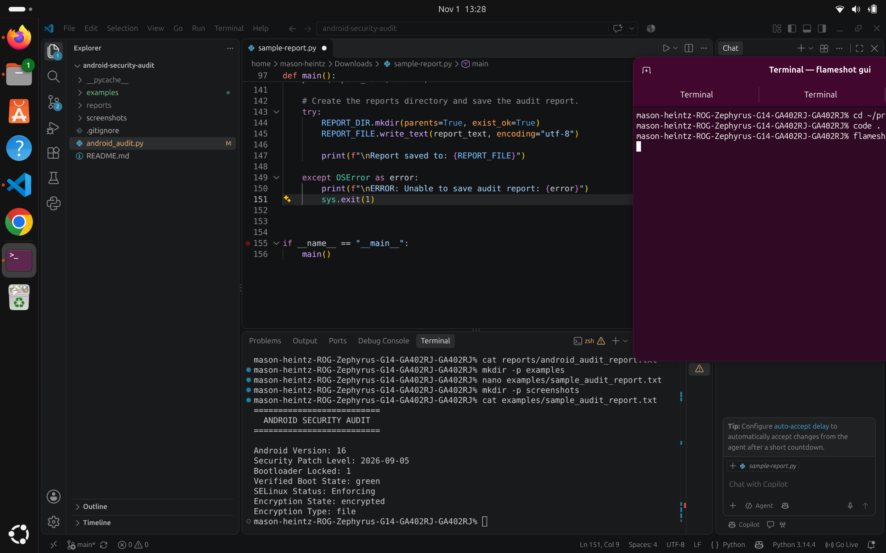

# Android Security Audit

## Overview

Android Security Audit is a Python command-line tool that uses Android Debug Bridge (ADB) to collect basic security configuration information from a connected Android device.

The tool performs seven checks covering Android version, security patch level, bootloader lock status, Verified Boot state, SELinux status, and encryption configuration.

Results are displayed in the terminal and saved to a local text report for review.

## Sample Audit Report

The following is an example of the report generated by the tool.



You can also view the [sample audit report](examples/sample_audit_report.txt).

## Features

- Collects seven Android security configuration indicators.
- Checks for a connected and authorized Android device before starting.
- Uses read-only ADB commands to retrieve device information.
- Handles common connection errors and command timeouts.
- Displays audit results in the terminal.
- Generates a local text report using Python's pathlib module.

## Requirements

Before running the audit, you need:

- Python 3
- Android Debug Bridge (ADB), included in Android SDK Platform Tools
- An Android device connected to your computer using USB
- USB debugging enabled on the Android device
- Authorization to communicate with the device through ADB

## Setup

1. Install Python 3 and Android SDK Platform Tools if they are not already installed.
2. Clone this repository to your computer.
3. Connect your Android device using USB.
4. Enable USB debugging in Android's Developer options.
5. Unlock your device and approve the USB debugging authorization prompt.
6. Open a terminal in the project directory.

## Running the Audit

Confirm that your Android device is connected and authorized:

```bash
adb devices
```

Run the audit:

```bash
python3 android_audit.py
```

The script collects the seven security indicators, displays the results in the terminal, and saves a report to:

```text
reports/android_audit_report.txt
```

The report is overwritten each time the audit runs successfully.

## Security Checks Explained

The audit collects seven security-related values from the connected Android device.

| Check | What It Measures | Why It Matters |
|---|---|---|
| Android Version | The installed Android version. | Helps identify the operating system version running on the device. |
| Security Patch Level | The reported Android security patch date. | Helps assess how recently the device's Android security components were patched. |
| Bootloader Locked | Whether the bootloader reports itself as locked. | Bootloader lock status is an important part of Android's device integrity protections. |
| Verified Boot State | The device's reported verified boot status. | Helps assess whether Android's Verified Boot process reports a trusted system state. |
| SELinux Status | Whether SELinux is enforcing its security policies. | SELinux helps restrict what processes can access and do on the system. |
| Encryption State | The reported device encryption state. | Encryption helps protect stored data against unauthorized access. |
| Encryption Type | The reported encryption type. | Identifies the encryption approach reported by the device, such as file-based encryption. |

These values provide basic security indicators. They do not constitute a complete security assessment or guarantee that a device is secure.

## Technical Implementation

The project uses Python's standard library to interact with Android Debug Bridge and organize audit results.

- **subprocess:** Executes ADB commands and captures their output.
- **ADB shell:** Retrieves Android configuration properties using commands such as `getprop` and `getenforce`.
- **Device validation:** Checks whether exactly one authorized Android device is connected before running the audit.
- **Error handling:** Handles missing ADB installations, unauthorized devices, command timeouts, and report-writing errors.
- **pathlib:** Creates the report directory and writes the generated audit report to a local text file.

No third-party Python packages are required.

## Limitations

- This tool performs a basic configuration audit, not a comprehensive security assessment.
- Results depend on the information exposed by the connected Android device.
- Some Android properties may be unavailable or behave differently across manufacturers and device models.
- A reported security patch level does not independently confirm that every available security update is installed.
- A locked bootloader, a green Verified Boot state, and enabled encryption are useful security indicators, but they do not guarantee that a device is free from vulnerabilities or compromise.

## Privacy and Report Handling

- Run this tool only on Android devices you own or have explicit permission to assess.
- The audit uses read-only ADB commands to retrieve security configuration information.
- Reports are saved locally in `reports/android_audit_report.txt`.
- The `reports/` directory is included in `.gitignore` to help prevent device-specific reports from being committed to the repository.
- Review report contents before sharing them because device information may reveal details about your device's configuration.

## Future Improvements

- Expand security checks to collect additional Android configuration information.
- Improve reporting with structured output formats such as JSON.
- Add more detailed explanations of individual security findings.
- Improve compatibility across different Android manufacturers and device models.
